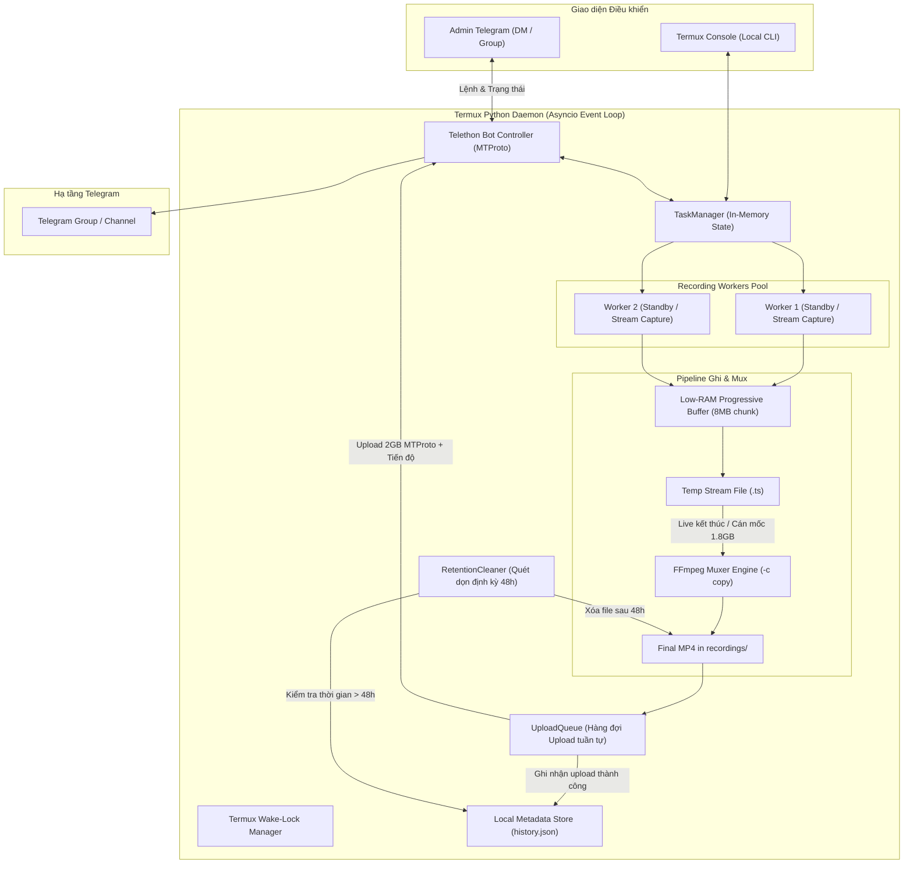

# Thiết kế kỹ thuật: Chaturbate Recorder trên Android Termux & Tích hợp Telegram Bot (Telethon MTProto)

## 1. Intent & The Why
- **Bối cảnh**: `rec2-depseek.py` là một công cụ ghi luồng Chaturbate hiệu năng cao với kiến trúc Pure-RAM pipeline sang ổ cứng NVMe, được tối ưu cho môi trường Linux server x86_64 có `/dev/shm`, GNU libc (`libc.so.6`), và RAM dồi dào (~1 GB buffer).
- **Mục tiêu**: Người dùng chuyển đổi script này để chạy 24/7 trên thiết bị Android thông qua môi trường Termux (cài đặt từ F-Droid), biến điện thoại thành một trạm ghi hình di động, độc lập, tiêu thụ điện năng thấp.
- **Tính năng mới**: Tích hợp Telegram Bot bằng **Bot Token tạo từ @BotFather** (kết nối giao thức **MTProto qua Telethon**) để người dùng giám sát, điều khiển từ xa và tự động upload video đã ghi/mux sang nhóm Telegram (hỗ trợ file lên tới 2.000 MB). Video sau khi upload được **lưu trữ cục bộ trong 48 giờ trước khi tự động xóa**.

---

## 2. Goals, Non-Goals, Anti-Goals

### Goals
- **Android Termux Native Compatibility**: Chạy mượt mà trên Termux (Python 3.10+, FFmpeg cài qua `pkg install ffmpeg python`), tương thích với Android Bionic libc (`libc.so`), giải quyết triệt để vấn đề không có `/dev/shm` và rào cản SELinux `/proc` trên Android 10+.
- **Resource & Memory Safety**: Đảm bảo tổng mức tiêu thụ RAM luôn dưới 100 MB để không bị Android Low Memory Killer (LMK) cưỡng chế tắt Termux.
- **Background Execution Resilience**: Tự động kích hoạt `termux-wake-lock` khi khởi động để giữ CPU chạy liên tục khi tắt màn hình, và `termux-wake-unlock` khi tắt app.
- **Telegram Remote Control**: Hỗ trợ đầy đủ lệnh điều khiển từ xa: `/status`, `/rec <user>`, `/stop <user|all>`, `/fav`, `/add <user>`, `/del <user>`, `/files`, `/help`. Cho phép điều khiển qua cả tin nhắn riêng (DM với Admin) lẫn trong Group chỉ định.
- **Telegram Large File Auto-Upload (Up to 2 GB)**: Dùng Telethon MTProto với Bot Token để upload video lên đến 2.000 MB kèm cập nhật tiến độ (progress bar) và caption chi tiết.
- **48-Hour Retention Lifecycle**: Quản lý vòng đời lưu trữ: video sau khi upload thành công sẽ được giữ lại 48 giờ trên bộ nhớ thiết bị, sau đó tiến trình nền `RetentionCleaner` sẽ tự động dọn dẹp để tiết kiệm dung lượng. Có cơ chế xả khẩn cấp nếu dung lượng bộ nhớ trống xuống dưới ngưỡng an toàn `MIN_FREE_MB`.
- **Single Continuous Video per Session**: Không xé vụn video thành nhiều phần nhỏ 10-15 phút. Luồng stream được ghi cuốn chiếu liên tục cho đến khi kết thúc phiên live (hoặc khi file đạt ngưỡng trần an toàn 1.8 GB của Telegram).

### Non-Goals
- Không xây dựng UI Android native (chạy 100% trong Termux daemon).
- Không re-encode lại video khi mux (dùng stream copy `-c copy` để tải CPU < 2%).

### Anti-Goals
- Không phụ thuộc vào đọc `/proc` của hệ điều hành.
- Không dùng HTTP Bot API thông thường (bị giới hạn 50 MB không thể upload video dài).

---

## 3. Constraints
1. **Nền tảng**: Android 9.0+ với Termux F-Droid.
2. **Thư viện**: Python 3.10+, `telethon`, `ffmpeg`, `ffprobe`.
3. **Telegram Limits**: Tối đa 2.000 MB (2 GB) cho mỗi file upload qua MTProto.
4. **Giới hạn luồng chạy đồng thời trên Mobile**: Tối đa 2 phòng ghi đồng thời mặc định (`MAX_CONCURRENT_RECORDINGS = 2`) để đảm bảo băng thông mạng và độ bền phần cứng điện thoại.

---

## 4. Kiến trúc Tổng thể & Dòng Dữ liệu (System Architecture)



---

## 5. Quy trình Hoạt động Cốt lõi (Core Workflow)

### Bước 1: Khởi động & Chuẩn bị Môi trường
1. Kích hoạt `termux-wake-lock` qua subprocess để CPU không bị ngắt khi tắt màn hình.
2. Kiểm tra `ffmpeg`, `ffprobe` trong `$PREFIX/bin`.
3. Kiểm tra các thư mục: `recordings/`, `tmp/` (ưu tiên `$TMPDIR` của Termux).
4. Khởi chạy `Telethon Client` với `bot_token`, `api_id`, `api_hash`.
5. Đọc danh sách `favorites.txt`, nạp các streamer vào `TaskManager` ở trạng thái `STANDBY`.

### Bước 2: Chu trình Thăm dò & Phát hiện Live (Standby Loop)
1. Cứ mỗi 30-35 giây (hoặc giãn cách ngẫu nhiên 0.3s giữa các phòng), worker gửi HTTP request kiểm tra API Chaturbate.
2. Nếu streamer chuyển sang `ONLINE (PUBLIC)`:
   - Gửi thông báo đến Telegram: `🔴 [LIVE] <username> đang phát sóng! Bắt đầu ghi hình...`.
   - Chuyển trạng thái worker sang `RECORDING`.

### Bước 3: Ghi hình Tối ưu RAM (Low-RAM Progressive Streaming)
- **Cơ chế ghi**:
  - Không giữ hàng trăm MB trong RAM! Các TS segments tải về được giữ trong một buffer nhỏ (8 - 16 MB) và ghi cuốn chiếu ngay xuống file tạm `tmp/<room>_<timestamp>.raw.ts`.
  - Mức RAM heap của tiến trình chỉ dao động 40 MB - 70 MB.
  - Theo dõi dung lượng file: Nếu luồng kéo dài khiến file thô chạm mốc **1.800 MB (1.8 GB)**, worker chủ động cắt chunk để đảm bảo không vượt trần 2 GB của Telegram.

### Bước 4: Muxing sang MP4
1. Khi streamer kết thúc live (hoặc khi đạt trần 1.8 GB):
   - Worker gọi FFmpeg thực hiện đóng gói nhanh:
     `ffmpeg -y -i tmp/...raw.ts -c copy -movflags +faststart recordings/chaturbate_<room>_<date>_<time>.mp4`
   - Quá trình stream-copy `-c copy` chỉ mất vài giây đến 1-2 phút, không tốn CPU.
   - Xóa ngay file tạm `.raw.ts`.
2. Chuyển đối tượng sang `UploadQueue`.

### Bước 5: Hàng đợi Upload Telegram (MTProto 2GB)
1. Worker trong `UploadQueue` nhặt video và gửi tin nhắn ban đầu:
   `⏳ Đang tải lên: chaturbate_<room>_...mp4 (Dung lượng: 450 MB) [0%]`
2. Gọi `client.send_file()` sử dụng MTProto chunk streaming.
3. Cứ mỗi 5-10 giây hoặc tăng thêm 10%, bot cập nhật (edit) tin nhắn tiến độ để tránh bị hạn chế tần suất (Telegram FloodWait limit).
4. Khi upload xong:
   - Xóa tin nhắn tiến độ tạm, gửi video hoàn chỉnh kèm caption đẹp:
     ```text
     📹 [RECORDED] #room_name
     🕒 Thời gian: 2026-11-08 14:00 - 15:30 (1h30m)
     📦 Dung lượng: 450.2 MB | 1080p
     ⏳ Lưu trữ máy: 48 giờ trước khi xóa tự động.
     ```
   - Ghi bản ghi vào `history.json`:
     `{"file": "chaturbate_xxx.mp4", "uploaded_at": "2026-11-08T15:32:00Z", "room": "xxx", "size": 472000000, "status": "uploaded"}`

### Bước 6: Vòng đời Lưu trữ 48 Giờ (Retention Policy)
1. Tiến trình ngầm `RetentionCleaner` thức dậy mỗi 30 phút một lần.
2. Quét danh sách trong `history.json`:
   - Nếu `(thời gian hiện tại - uploaded_at) >= 48 * 3600` giây:
     - Thực hiện xóa file `recordings/<file>.mp4`.
     - Cập nhật trạng thái trong `history.json` thành `"purged"`.
3. **Cơ chế khẩn cấp (Emergency Low-Disk Eviction)**:
   - Nếu dung lượng trống của máy dưới `MIN_FREE_MB` (mặc định 400 MB), hệ thống tự động xóa sớm các file đã upload cũ nhất (dù chưa đủ 48h) và gửi thông báo cảnh báo về Telegram.

---

## 6. Cấu trúc Mô-đun Code Chi tiết

1. **`core/config.py`**: Quản lý nạp file `settings.txt` (hỗ trợ `TELEGRAM_API_ID`, `TELEGRAM_API_HASH`, `TELEGRAM_BOT_TOKEN`, `TELEGRAM_CHAT_ID`, `ADMIN_IDS`, `RETENTION_HOURS=48`, `MAX_CONCURRENT=2`).
2. **`core/android.py`**: Tương thích Android: `wake_lock()`, `wake_unlock()`, fallback thư mục tmp Termux, an toàn gọi `malloc_trim` qua `libc.so`.
3. **`core/task_manager.py`**: Quản lý in-memory dictionary các `RecordingJob`, không dùng `/proc`.
4. **`core/recorder.py`**: Vòng lặp HLS streaming cuốn chiếu, buffer RAM nhỏ 8-16MB, xoay vòng khi chạm 1.8GB.
5. **`core/muxer.py`**: Wrapper FFmpeg stream-copy sang `.mp4` chuẩn faststart.
6. **`bot/telegram_bot.py`**: Telethon Client, xử lý lệnh `/start`, `/rec`, `/stop`, `/status`, `/fav`, `/add`, `/del`, `/files`.
7. **`bot/uploader.py`**: `UploadQueue` bất đồng bộ xử lý tuần tự, chống nghẽn mạng trên thiết bị di động.
8. **`storage/cleaner.py`**: Quản lý `history.json` và chu trình dọn dẹp sau 48h.
